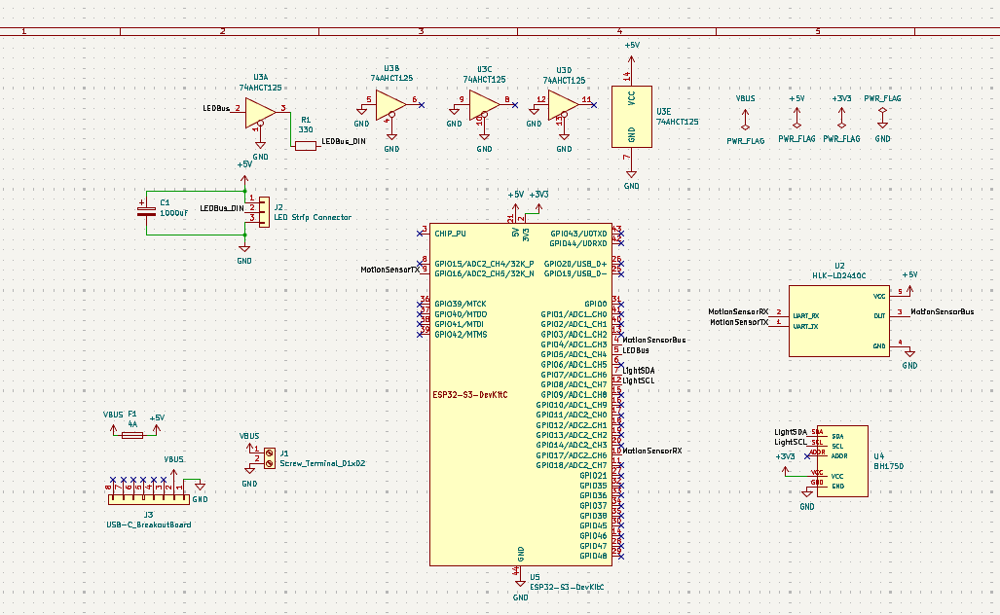
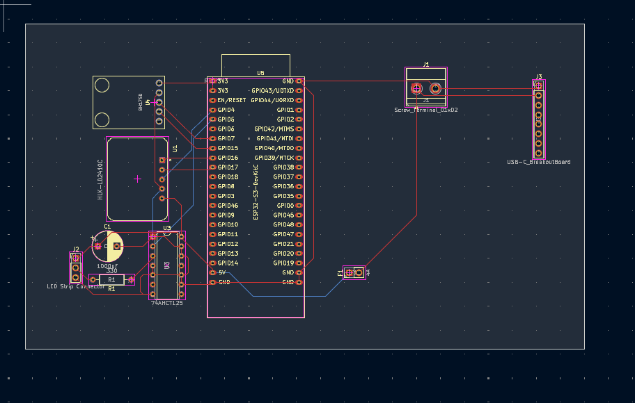
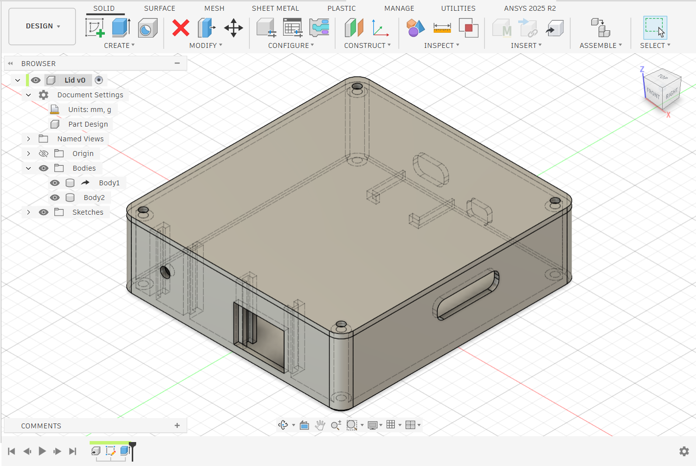
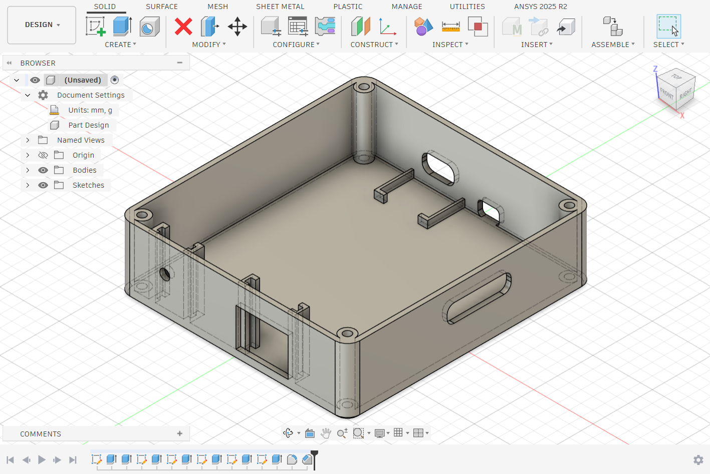

# AutomaticLights

This is a system to automatically turn on your RGB strip lights, using LD2410C motion sensors for presence detection,
and a BH105 light sensor for changing brightness based on ambient lighting. 

## Description

This system was built due to my room's lack of RGB strip lighting. I have always wanted some but I never had any,
and I also never bought any because I dind't want the hassle of turning them on and off all the time. And keeping them on
all the time would draw too much electricity. So I wanted to build a system where the lights will turn on and off based on if I
am at my desk or in the room. This makes it really easy to maintain and make sure it is not drawing too much power.

## Features

* 3D Printed Case
* RGB Strip Lights
* Presence Detection using a LD2410C sensor
* Ambient Lighting detection using a BH105 sensor
* USB - C Powered and USB - C programmable
* Hand wired

## Schematic

Since the project is hand wired there is no real need for a schematic but I decided to make one anyway to make it easy to keep track
of what components connect to what, and approximately where each component will be (done with the layout and routing in the PCB editor of KiCad). I plan to use a perfboard to connect everything together. Some symbols and footprints were used from SnapMagic.

## CAD

Custom 3D Printable case which houses all of the electronics for the project other than the RGB lightstrip itself. It has a base, which
houses the main perfboard, the USB-C breakout board, the BH105 sensor and the LD2410C sensor. Each sensor and the breakout board
has certain slots to fit into to keep them in the right spot, so that they stay consistent and don't move around if the box is moved.
It also has the holes for the power USB-C, the RGB light strip's wires, and the programming USB-C and MicroUSB ports. Make sure to never
plug a USB into the programming ports if it is also recieving power from the power port. For the lid, it is attached to the case using M2 
screws with M2 screw's threaded inserts. 

## Firmware

The firmware currently can control the RGB lights based on if the LD2410C sensor detects anything. It also adjusts the brightness of the 
lights based on the ambient lighting detected by the BH105 sensor. I will also later add ability to control my room's lights based
on if I enter the room, and adjust the different colors and flows of the LED light strip. It can be found in the firmware folder, the code.py
file should be uploaded to the ESP32 which should already be flashed with circuit python. I would reccomend for autocomplete and to get
the correct libraries for offline development without an ESP32, use the .venv python interpreter in VSCode to be able to have a proper autocomplete and not be riddled with warnings and errors. For the best experience make sure VSCode has the firmware folder itself open
otherwise it will not detect the additional library used in the lib folder under the firmware folder.   

## Bill Of Materials (BOM)

| Item | Description | Preowned | # of Sets | # Pcs / Set | Price / Set (USD) | Item Total Price + Tax & Shipping (USD) | Supplier | URL|
| :--  | :---------- | :------- | :-------- | :---------- | :---------------- | :-------------------------------------- | :------- |:-- |
| ESP32-S3-DevKitC-1 | Microcontroller | NO | 1 | 1 | $6.41 | *$6.41* | Aliexpress | https://www.aliexpress.com/item/1005006429853362.html|
| HLK-LD2410C 24G    | Motion sensor   | NO | 1 | 1 | $3.75 | *$3.75* | Aliexpress | https://www.aliexpress.com/item/1005005629674638.html |
| SN74AHCT125N       | Level Shifter   | NO | 1 | 1 | $2.07 | *$2.07* | Aliexpress | https://www.aliexpress.com/item/1005007655828920.html |
| GY-302 BH1750      | Light Sensor    | NO | 1 | 1	| $1.90	| *$1.90* | Aliexpress | https://www.aliexpress.com/item/1005010446317363.html |
| Glass Fuse Holder 22 AWG with 4A Glass Fuse | Fuse Holder & Fuse | NO | 1	| 5	| $2.74	| *$2.74* | Aliexpress | https://www.aliexpress.com/item/1005007846817140.html |
| Terminal Block Connector Pitch 5.0mm - 2P Green | Screw Terminal | NO | 1	| 10 | $1.84 | *$1.84* | Aliexpress | https://www.aliexpress.com/item/1005007055503766.html |
| Aluminum Electrolytic Capacitor 10V 1000UF | Capacitor | NO | 1 | 20 | $3.93 | *$3.93* | Aliexpress | https://www.aliexpress.com/item/1005011811368397.html |
| Metal Film Resistors - 330Ω | Resistors | YES | 1 | 100 | $3.79 | *$3.79* | Aliexpress | https://www.aliexpress.com/item/1005003021542565.html |
| USB-C Breakout Board | Power | YES | 1 | 1 | $1.13 | *$1.13* | Aliexpress | https://www.aliexpress.com/item/1005004848153846.html |
| WS2812B RGBIC Smart LED Strip - IP30 60 LEDS 2m | LED Strip | NO | 1 | 1 | $7.11 | $7.11 | Aliexpress | https://www.aliexpress.com/item/1005009135730524.html |
| **Grand Total (USD)** | | | | | | *$34.67* | | |
| **Grand Total New (USD)** | | | | | | *$29.75* | | |
